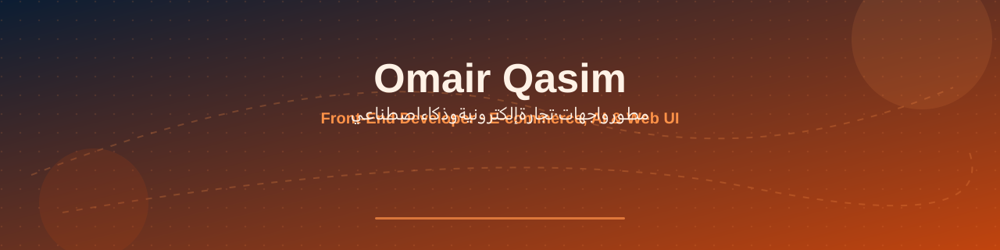
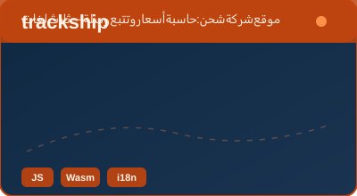
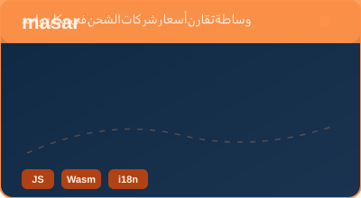
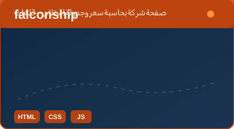
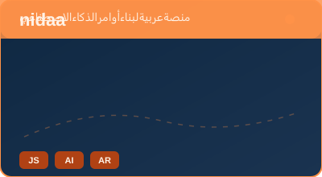

 · **omairggs@gmail.com**

## نبذة | About

**عربي** — مطوّر واجهات ويب أبني مواقع وتجارة إلكترونية للسوق السعودي: واجهات نظيفة مصمّمة في **Figma**، أتمتة مهام سير العمل، وأدوات ويب تفاعلية (حاسبات، لوحات، منشئات أوامر للذكاء الاصطناعي). أعمل بـ HTML وCSS وJavaScript وWebAssembly، مع دعم كامل للعربية وRTL/LTR وثلاث لغات أو أكثر — بدون إطارات ثقيلة.

**English** — I build fast, multilingual front-ends for the Saudi market: Figma-driven UI, workflow automation, and in-browser tools (calculators, dashboards, AI prompt builders). Stack: HTML, CSS, JavaScript, WebAssembly, Git — full RTL/LTR, lightweight and dependency-free where it matters.

## المشاريع | Projects

| المشروع | الوصف |
|---|---|
| [**trackship**](https://github.com/omairggs-bit/trackship) | موقع شركة شحن (جاف، مبرّد، دولي، مسار السودان): حاسبة أسعار، تتبّع، وسلة — JS + WebAssembly، 3 لغات. |
| [**masar**](https://github.com/omairggs-bit/masar) | منصة وساطة تقارن أسعار DHL وFedEx وأرامكس وتاركو في مكان واحد — JS + WebAssembly. |
| [**falconship**](https://github.com/omairggs-bit/falconship) | صفحة شركة: حاسبة سعر وجدولة استلام — HTML/CSS/JS، 3 لغات. |
| [**nidaa**](https://github.com/omairggs-bit/nidaa) | منصة عربية لبناء أوامر الذكاء الاصطناعي لـ ChatGPT وClaude وGemini وغيرها. |

## التقنيات | Tech Stack

`HTML` · `CSS` · `JavaScript` · `WebAssembly` · `Git` · `Figma` · **AI tools & prompt workflows** · **Task automation**

## ما أقدمه | What I Offer

- تصميم واجهات في Figma ثم تنفيذها كمواقع جاهزة للنشر  
- أتمتة مهام متكررة (نماذج، تدفقات، أدوات داخل المتصفح)  
- مواقع متاجر وتجارة إلكترونية متعددة اللغات مع RTL كامل  
- تكامل أدوات الذكاء الاصطناعي في المنتج (منشئات أوامر، مساعدات للعميل)

